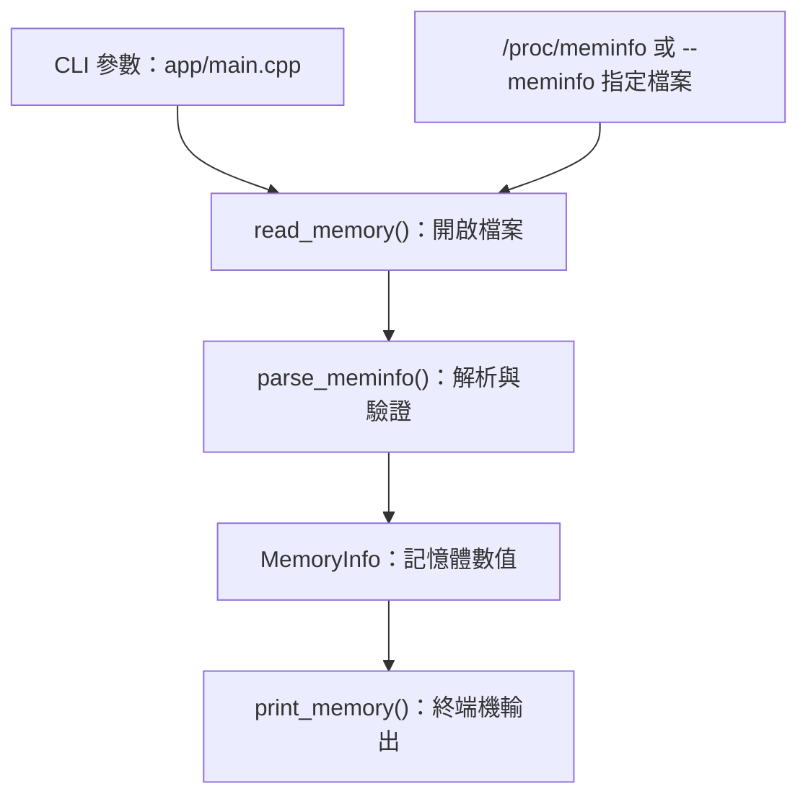

# linxray

C++20 Linux 系統資訊 CLI，讀取 `/proc/meminfo`，顯示記憶體總量、可用量、已用量與使用率

## 編譯

需要 C++20 編譯器與 CMake 3.20 以上。Windows 先在 PowerShell 執行 `wsl -d Ubuntu`；以下指令皆在 Linux／WSL 的專案根目錄執行

```bash
sudo apt update
sudo apt install build-essential cmake ninja-build
cmake -S . -B build -G Ninja -DCMAKE_BUILD_TYPE=Debug
cmake --build build
```

## 執行

```bash
./build/linxray memory
./build/linxray --help
```

修改程式後先執行 `cmake --build build`。已用量採 `MemTotal - MemAvailable`，單位為 GiB；WSL 中顯示的是 Linux 環境的數值

## 測試

```bash
ctest --test-dir build --output-on-failure
```

## 結構

```text
.                                 
├── app/                          # CLI 應用程式
│   └── main.cpp                  # 參數處理與文字輸出
├── include/linxray/              # 公開標頭
│   └── memory.hpp                # 記憶體資料型別與介面
├── src/                          # 核心實作
│   └── memory.cpp                # 讀取、解析與計算記憶體資訊
├── tests/                        # 測試與固定資料
│   ├── unit/memory_tests.cpp     # 核心單元測試
│   ├── cli/memory_cli.cmake      # CLI 輸出與退出碼測試
│   └── fixtures/                 # 測試資料
│       ├── meminfo.txt           # 正常輸入
│       └── meminfo-invalid.txt   # 異常輸入
├── CMakeLists.txt                # 編譯與測試設定
├── README.md                     # 使用說明
├── .gitignore                    # Git 忽略規則
├── .gitattributes                # Git 換行設定
└── build/                       
```

## 資料流程


