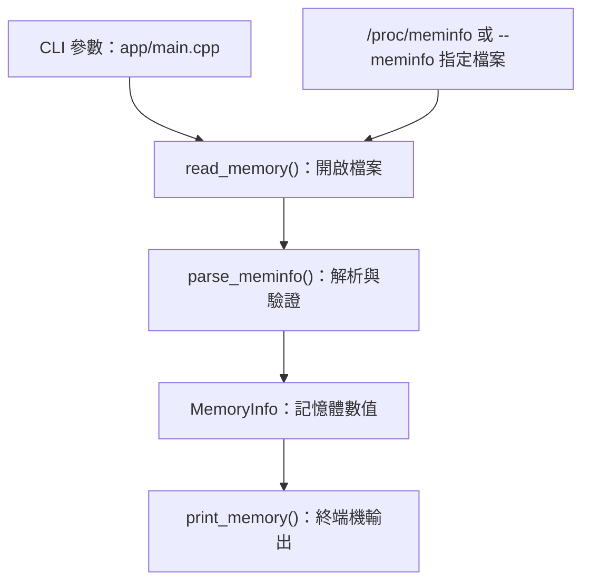

# linxray

C++20 Linux 系統資訊 CLI，讀取 `/proc/meminfo`，顯示記憶體總量、可用量、已用量與使用率。

## 編譯與執行

在 Linux 或 WSL2 Ubuntu 執行，需要 C++20 編譯器與 CMake 3.20 以上。

```bash
sudo apt update
sudo apt install build-essential cmake ninja-build
cmake -S . -B build -G Ninja -DCMAKE_BUILD_TYPE=Debug
cmake --build build
./build/linxray memory
./build/linxray --help
```

已用量採 `MemTotal - MemAvailable`，單位為 GiB。在 WSL 中顯示的是 Linux 環境的數值。

## 測試

```bash
ctest --test-dir build --output-on-failure
```

## 結構

- `app/`：CLI 入口與輸出
- `include/linxray/`、`src/`：公開介面與核心實作
- `tests/`：單元測試、CLI 測試與固定資料
- `build/`：自動產生的編譯檔案，不提交至 Git

```text
.
├── app/
│   └── main.cpp
├── include/linxray/
│   └── memory.hpp
├── src/
│   └── memory.cpp
├── tests/
│   ├── unit/memory_tests.cpp
│   ├── cli/memory_cli.cmake
│   └── fixtures/
│       ├── meminfo.txt
│       └── meminfo-invalid.txt
├── CMakeLists.txt
├── README.md
├── .gitignore
├── .gitattributes
└── build/                     # 自動產生
```

## 資料流程

成功查詢時，CLI 呼叫核心函式讀取、解析資料，再格式化輸出。


